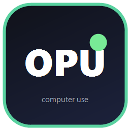

# OPCOMPUSE

**The fast, cheap, memory-smart computer-use plugin for OpenCode (Windows).**

Say `use opu` in OpenCode and the plugin reads your screen with **Windows UI
Automation + built-in OCR** (no screenshots, no vision-model tokens), keeps the
digest hot in a local cache (~1-5 ms reads), batched-acts **and verifies in one
call**, remembers desktop knowledge in compressed **apex-memory** for any AI,
and shows a live always-on-top indicator while working — with an instant STOP.

## Install

1. Run `opcompuse-installer.exe` (GUI wizard: features -> privacy & terms -> install -> done; self-signed, SHA-256 in the release notes).
   - Or CLI: `opcompuse-installer.exe silent` (no prompts), `norestart` flag available, `uninstall` removes it.
2. Or the PowerShell alternative `install-opcompuse.ps1` next to `opcompuse.zip`.
3. Start a session and say: **use opu** — or open `/opcompuse` for the watcher panel.

## What you get

- `opcompuse_state` — instant digest of the active window (elements / rects / clickable points / OCR / windows list)
- `opcompuse_act` — batched actions (click, type, keys, scrolls, UIA `invoke/select/set/toggle/...`) + built-in post-verification
- `opcompuse_find` — element regex search
- `opcompuse_decide` — cheap flash model reads the **text digest** when a screen is ambiguous (~$0.001)
- `opcompuse_memory` — apex-memory: compressed (`OAPX1`+gzip, ~50%), **de-duplicated** desktop knowledge
- `opcompuse_watch` — the watch-ahead cache loop (lazily starts, idle-adaptive)
- `opcompuse_settings` — runtime toggles: memory, auto-memory, confirm-on-save, access levels, models, intervals

## Safety

- Always-on-top HUD (`ps/OpuHud.exe`): `OPU WATCHING` / `OPU RUNNING` / `OPU STOPPED` / `OPU idle`
- **STOP button** on the HUD + global hotkey **Ctrl+Alt+Shift+X** + `/opstop` + panel key `x`
- `opcompuse_act` checks the stop gate before every step
- `access=minimal` disables pixel ops entirely (UIA/keyboard only)

## Privacy

Local-first. No telemetry. Credentials are never stored — saves matching username/password/token/key/email patterns are refused; typed text is never memorized (only the op chain). Full details in [PRIVACY.md](PRIVACY.md); terms in [TERMS.md](TERMS.md).

## Build

- Plugin code: `index.js` (server), `tui.tsx` (TUI panel), `rpc.js` (contract), `ps/*`.
- HUD: `ps/OpuHud.cs` -> `ps/OpuHud.exe` (csc /target:winexe).
- Installer GUI: `opcompuse-installer-src/InstallerGui.cs` -> `opcompuse-installer.exe` via `build.cmd` (csc, embeds `opcompuse.zip` + `logo.png`, icons via `logo.ico`).

## Data layout

- Plugin: `%USERPROFILE%\.opencode\plugins\opcompuse`
- Apex-memory: `%USERPROFILE%\.local\share\opencode\opcompuse\apex-memory`
- Watcher cache: `%TEMP%\opencode\opcompuse`
